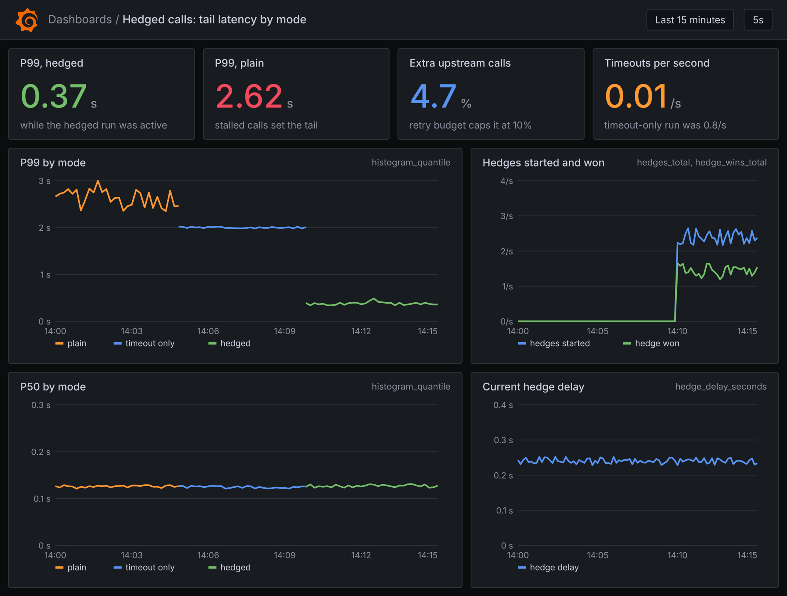
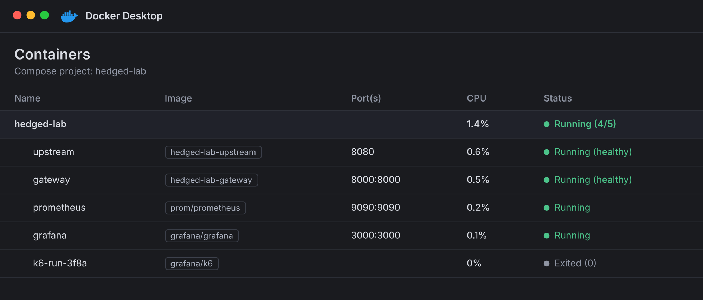

# hedged-llm-calls-lab

A small lab for one question: what does it take to cut the slowest 1% of calls to a slow model endpoint?

Most calls take about 120 ms. A few stall for seconds. Those few set your P99, and a plain retry or a timeout does not fix them. This repo lets you watch three approaches side by side:

- **plain**: call once and wait
- **timeout**: give up after 2 seconds
- **hedged**: if the first call is slower than usual, start a second one and keep whichever answers first

The hedging code is a tiny library in `hedgekit/`. It has no dependencies beyond the standard library.

## Run it

You need Docker. Then:

```bash
make up            # upstream, gateway, Prometheus and Grafana
make load-plain    # 3 minutes of load, one call per request
make load-timeout
make load-hedged
```

Open Grafana at http://localhost:3000. The dashboard loads on its own.





`make down` stops everything.

## No Docker?

```bash
make install
make test
make simulate      # runs all three modes in one process
```

## How the hedge works

1. The gateway keeps the last 1,000 normal latencies and uses their P95 as the hedge delay.
2. If the first call is still running after that delay, it starts one more.
3. The first answer wins and the other call is cancelled.
4. A retry budget limits extra calls to about 10% of traffic, so hedging cannot flood a struggling upstream.

Only use it for calls that are safe to run twice, such as reads and idempotent requests.

## Layout

| Path | What it is |
| --- | --- |
| `hedgekit/` | timeout, hedge and retry budget code |
| `upstream/` | a slow endpoint with a long tail |
| `gateway/` | FastAPI app that runs the three modes and exports metrics |
| `k6/` | load script with a fixed arrival rate |
| `observability/` | Prometheus config and the Grafana dashboard |
| `scripts/simulate.py` | in-process comparison with no network |

## A note on the numbers

The upstream is simulated. It shows the shape of the trade-off, not the numbers your own service will give you. Point `UPSTREAM_URL` at a real endpoint to measure that.
